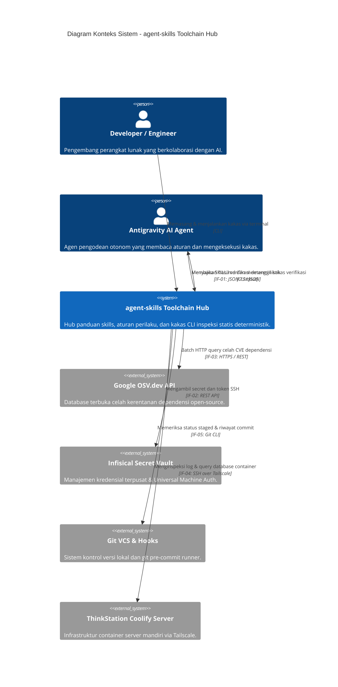

# 3. Konteks dan Cakupan (Context and Scope)

> [!INFO] **Architecture Provenance & Freshness**
> - **Verified Commit**: `68c36e2` (branch: `main`)
> - **Verified Timestamp**: `2026-10-29T14:04:00+07:00`
> - **Tracked Paths**: `skills/`, `config/`, `install.sh`
> - **Drift Status**: `verified`

Dokumen ini mendefinisikan batasan sistem repositori **`agent-skills`**, membedakan tanggung jawab internal sistem dengan entitas dan antarmuka eksternal di sekitarnya.

---

## 3.1 Diagram Konteks Bisnis & Teknis (Mermaid C4 Context)

---

## 3.2 Antarmuka Eksternal Sistem (External Interfaces)

Berikut adalah daftar antarmuka formal yang menghubungkan komponen internal `agent-skills` dengan ekosistem luar:

| ID Interface | Nama Antarmuka | Protokol / Format | Deskripsi & Komponen Pengguna |
|:---|:---|:---|:---|
| IF-01 | Antigravity CLI / AGY Runner Interface | Process execution / JSON / Stdout | Antarmuka pemanggilan kakas CLI (`static-srp-analyzer`, `codegraph-impact`, `vsa-boundary-checker`, `detect-mocks`, `arc42-lint`, `osv-scanner-gate`) oleh IDE atau AGY agent. |
| IF-02 | Infisical Universal Auth API | HTTPS / JSON REST API | Antarmuka autentikasi mesin terpusat untuk injeksi secret runtime dan provisi SSH key tanpa menyimpan password di disk lokal. |
| IF-03 | Google OSV.dev Batch Vulnerability API | HTTPS / JSON REST API (HTTP/2) | Antarmuka kueri batch terdistribusi untuk mengecek *package hash* dan versi manifest terhadap database CVE terbuka di `api.osv.dev`. |
| IF-04 | Tailscale Mesh & SSH Transport | Encrypted WireGuard / SSH Protocol | Antarmuka transportasi aman untuk manajemen kontainer Coolify dan query database jarak jauh (`*.dvlpid.my.id`). |
| IF-05 | Git VCS & Pre-Commit Hook Runner | Git Native CLI / Hook Subprocess | Antarmuka integrasi pra-commit untuk memeriksa *staged files*, menghitung jarak commit *drift*, dan memvalidasi integritas sebelum commit. |
