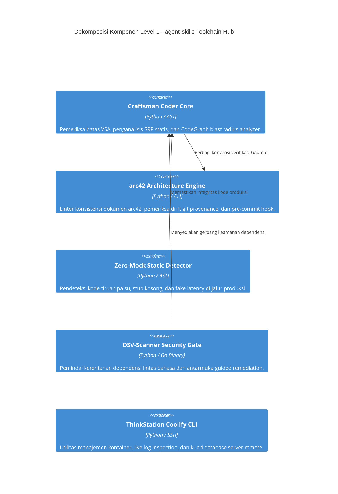

# 5. Bagian Penyusun Sistem (Building Block View)

> [!INFO] **Architecture Provenance & Freshness**
> - **Verified Commit**: `7ed205b` (branch: `main`)
> - **Verified Timestamp**: `2026-10-29T13:02:00+07:00`
> - **Tracked Paths**: `skills/`, `config/`, `install.sh`
> - **Drift Status**: `verified`

Dokumen ini menguraikan dekomposisi hierarki komponen penyusun repositori `agent-skills` (Level-1 dan Level-2 C4 model).

---

## 5.1 Dekomposisi Sistem Level 1 (C4 Container View)

---

## 5.2 Tabel Komponen Utama Level 1

Berikut adalah rincian komponen Level 1, keterhubungannya dengan antarmuka formal (`IF-xx`), serta lokasi implementasinya dalam direktori proyek:

| Komponen / Component | Deskripsi Tanggung Jawab | Interface | Lokasi Sumber |
|:---|:---|:---|:---|
| Craftsman Coder Core | Mengorkestrasi aturan SOLID, Single Responsibility Principle (`static-srp-analyzer`), pemetaan dampak AST blast radius (`codegraph-impact`), dan penegakan batas modular arsitektur irisan vertikal (`vsa-boundary-checker`). | IF-01, IF-05 | `skills/craftsman-coder/` |
| arc42 Architecture Engine | Mengelola dokumentasi arsitektur modular 12-bagian, memvalidasi keterlacakan tag mutu Q42, menguji keselarasan interface `IF-xx`, serta memblokir commit yang mengalami *architecture drift* (`arc42-lint`, `arc42-pre-commit`). | IF-01, IF-05 | `skills/arc42-architect/` |
| Zero-Mock Static Detector | Memeriksa AST seluruh file produksi untuk mendeteksi import pustaka mock, *fake sleep*, nilai return bohong (*dummy boolean/zero*), dan polusi berkas catatan agen (`notes.md`). Menegakkan kebijakan Dual-Tier Verification. | IF-01, IF-05 | `skills/zero-mock-detector/` |
| OSV-Scanner Security Gate | Memindai manifest dan lockfile poliglota terhadap database `api.osv.dev` menggunakan Google OSV-Scanner; menyediakan mode pre-commit staged ultra-cepat (`osv-scanner-gate --staged`) dan perbaikan terarah (`osv-scanner fix`). | IF-01, IF-03, IF-05 | `skills/osv-scanner/` |
| ThinkStation Coolify CLI | Menyediakan kakas operasional agnostik untuk menemukan kontainer Docker, memantau *queue deployment*, membaca log langsung, dan mengeksekusi query database dengan kredensial JIT dari Infisical. | IF-01, IF-02, IF-04 | `skills/thinkstation-coolify/` |

---

## 5.3 Dekomposisi Komponen Level 2 (Detail Internal)

### 1. Craftsman Coder Core (`skills/craftsman-coder/`)
- **`scripts/static_srp_analyzer.py`**: Mengurai AST Python/JS/PHP untuk menghitung metrik panjang class (>180 baris) dan fungsi (>50 baris), serta mendeteksi pemanggilan mentah SQL/HTTP di luar layer adapter.
- **`scripts/codegraph_impact.py`**: Memetakan grafik pemanggilan (*caller-callee graph*) dan menentukan risiko *blast radius* (Low/Medium/High/Critical) sebelum refactoring.
- **`scripts/vsa_boundary_checker.py`**: Memastikan kode di `features/A/` tidak melakukan import langsung ke `features/B/` tanpa melalui mediator/event bus.

### 2. OSV-Scanner Security Gate (`skills/osv-scanner/`)
- **`scripts/osv_scanner_gate.py`**:
  - `is_manifest_file(path)`: Mengidentifikasi berkas manifest/lockfile dari 10+ bahasa pemrograman.
  - `calculate_cvss3_score(vector)`: Menghitung skor CVSS v3.1 desimal murni berbasis formula matematika FIRST.org tanpa pustaka eksternal.
  - `run_osv_scan(...)`: Membungkus eksekusi biner Google OSV-Scanner dengan output JSON terstruktur.
- **`tests/test_osv_scanner_gate.py`**: Rangkaian 9 pengujian hermetis zero-network.

### 3. arc42 Architecture Engine (`skills/arc42-architect/`)
- **`scripts/arc42-lint.py`**: Engine linter arsitektur dengan 8 aturan verifikasi otomatis (`RULE-1` hingga `RULE-8`).
- **`scripts/languages/`**: Kamus bahasa multibahasa (ID, EN, DE, FR, ES, IT, PT) untuk mengenali heading dan pola tabel arsitektur secara internasional.
- **`scripts/arc42-pre-commit`**: Script pembungkus hook Git pre-commit.
