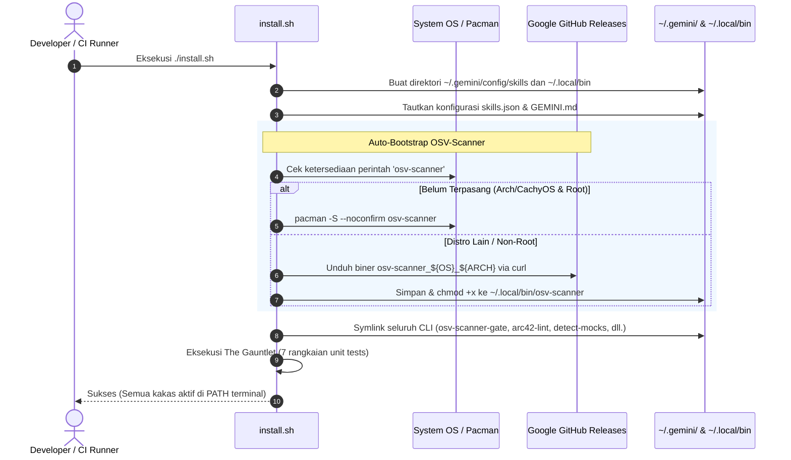

# 6. Alur Eksekusi Sistem (Runtime View)

> [!INFO] **Architecture Provenance & Freshness**
> - **Verified Commit**: `e284acb` (branch: `main`)
> - **Verified Timestamp**: `2026-10-29T12:54:18+07:00`
> - **Tracked Paths**: `skills/`, `config/`, `install.sh`
> - **Drift Status**: `verified`

Dokumen ini memetakan alur interaksi dinamis antar komponen selama skenario kritis dalam siklus pengembangan.

---

## 6.1 Skenario 1: Bootstrap Lingkungan Baru (`install.sh`)

Skenario ini terjadi saat developer atau CI/CD runner baru memasang `agent-skills` melalui perintah instalasi satu baris:



---

## 6.2 Skenario 2: Alur Pra-Commit Gauntlet (`git commit`)

Ketika pengembang atau agen AI menjalankan `git commit` pada repositori proyek:

```mermaid
sequenceDiagram
    autonumber
    actor Agent as AI Agent / Developer
    participant Git as Git Pre-Commit Hook
    participant OSV as osv-scanner-gate (--staged)
    participant Arc as arc42-pre-commit
    participant API as Google OSV.dev API

    Agent->>Git: git commit -m "feat: add payment gateway"
    Git->>OSV: Jalankan pemeriksaan staged files
    
    alt Tidak Ada Manifest/Lockfile yang Di-stage
        OSV-->>Git: Exit 0 (Bypass instan <0.05s)
    else Ada Manifest Di-stage (misal: composer.lock)
        OSV->>API: Batch HTTP Query package hashes
        API-->>OSV: Respon kerentanan CVE
        alt Celah CVE Ditemukan (CVSS >= ambang batas)
            OSV-->>Git: Exit 1 (Tolak commit, tampilkan tabel CVE)
            Git-->>Agent: Commit dibatalkan; rekomendasikan 'osv-scanner fix'
        else Bebas Celah
            OSV-->>Git: Exit 0 (Lulus)
        end
    end

    Git->>Arc: Periksa arsitektur drift & freshness
    alt Dokumentasi Mengalami Drift (>15 commit)
        Arc-->>Git: Exit 1 (Tolak commit)
        Git-->>Agent: Wajib perbarui docs/architecture/
    else Arsitektur Sinkron
        Arc-->>Git: Exit 0 (Lulus)
        Git-->>Agent: Commit berhasil disimpan!
    end
```

---

## 6.3 Skenario 3: Alur Refactoring Berbasis Dampak AST ("Old Coder" Loop)

Ketika agen AI ditugaskan merefaktor atau memperbaiki bug pada fungsi kritis:
1. **Analisis Dampak AST**: Agen mengeksekusi `codegraph-impact <repo> --symbol <TargetSymbol>` untuk memetakan pemanggil (*direct callers*) dan test suite yang terpengaruh.
2. **Penyusunan Tes Hermetis (RED)**: Agen membuat unit test terisolasi yang mendemonstrasikan ekspektasi baru.
3. **Implementasi Bersih (GREEN)**: Agen menulis perubahan implementasi dengan mematuhi batas SRP.
4. **Inspeksi Statis (REFACTOR & GAUNTLET)**:
   - Menjalankan `static-srp-analyzer` untuk memastikan tidak ada fungsi melampaui batas baris.
   - Menjalankan `detect-mocks` untuk memastikan tidak ada mock yang bocor ke kode produksi.
   - Menjalankan `osv-scanner-gate --staged` untuk memastikan tidak ada CVE baru yang masuk.
5. **Bukti Terminal (EVIDENCE)**: Menyajikan log terminal exit code `0` sebagai bukti keberhasilan.
