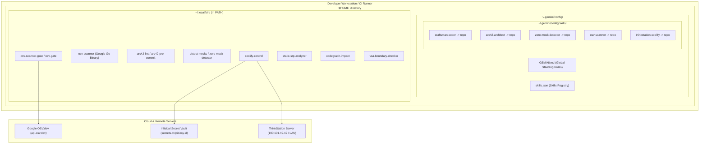

# 7. Tampilan Penyebaran (Deployment View)

> [!INFO] **Architecture Provenance & Freshness**
> - **Verified Commit**: `606a98b` (branch: `main`)
> - **Verified Timestamp**: `2026-10-29T13:30:00+07:00`
> - **Tracked Paths**: `skills/`, `config/`, `install.sh`
> - **Drift Status**: `verified`

Dokumen ini menjelaskan topologi fisik dan infrastruktur lingkungan tempat seluruh komponen repositori `agent-skills` disebarkan dan dieksekusi.

---

## 7.1 Topologi Penyebaran Infrastruktur

---

## 7.2 Pemetaan Komponen ke Node Infrastruktur

Berikut adalah pemetaan penyebaran setiap blok pembangun Level 1 ke dalam sistem file lokal dan lingkungan eksekusi:

1. **Craftsman Coder Core**:
   - **Lokasi Fisik**: Disimpan di `skills/craftsman-coder/` dan disymlink ke `~/.gemini/config/skills/craftsman-coder`.
   - **Kakas Eksekusi**: Biner perintah mandiri ditautkan ke `~/.local/bin/static-srp-analyzer`, `~/.local/bin/codegraph-impact`, dan `~/.local/bin/vsa-boundary-checker`.
   - **Runtime**: Python 3.9+ Standard Library tanpa dependensi eksternal.

2. **arc42 Architecture Engine**:
   - **Lokasi Fisik**: Disimpan di `skills/arc42-architect/` dan disymlink ke `~/.gemini/config/skills/arc42-architect`.
   - **Kakas Eksekusi**: Ditautkan ke `~/.local/bin/arc42-lint` dan `~/.local/bin/arc42-pre-commit`.
   - **Kamus Bahasa**: Membaca file terjemahan JSON dari `skills/arc42-architect/scripts/languages/`.

3. **Zero-Mock Static Detector**:
   - **Lokasi Fisik**: Disimpan di `skills/zero-mock-detector/` dan disymlink ke `~/.gemini/config/skills/zero-mock-detector`.
   - **Kakas Eksekusi**: Ditautkan ke `~/.local/bin/detect-mocks` dan `~/.local/bin/zero-mock-detector` (serta `/usr/local/bin/` jika root).
   - **Runtime**: AST inspector mandiri Python standard library.

4. **OSV-Scanner Security Gate**:
   - **Lokasi Fisik**: Disimpan di `skills/osv-scanner/` dan disymlink ke `~/.gemini/config/skills/osv-scanner`.
   - **Kakas Eksekusi**: Ditautkan ke `~/.local/bin/osv-scanner-gate` dan `~/.local/bin/osv-gate`.
   - **Biner Pendukung**: Memanggil biner Go Google `osv-scanner` yang terpasang di `/usr/bin/osv-scanner` atau `~/.local/bin/osv-scanner`.
   - **Konektivitas Jaringan**: Menghubungi `https://api.osv.dev` melalui kueri batch HTTPS/2.

5. **ThinkStation Coolify CLI**:
   - **Lokasi Fisik**: Disimpan di `skills/thinkstation-coolify/` dan disymlink ke `~/.gemini/config/skills/thinkstation-coolify`.
   - **Kakas Eksekusi**: Ditautkan ke `~/.local/bin/coolify-control`.
   - **Konektivitas Jaringan**: Menghubungi Infisical Vault via HTTPS dan ThinkStation Coolify Server via WireGuard Tailscale Mesh (`100.101.49.42`) atau LAN IP (`192.168.0.136`).
