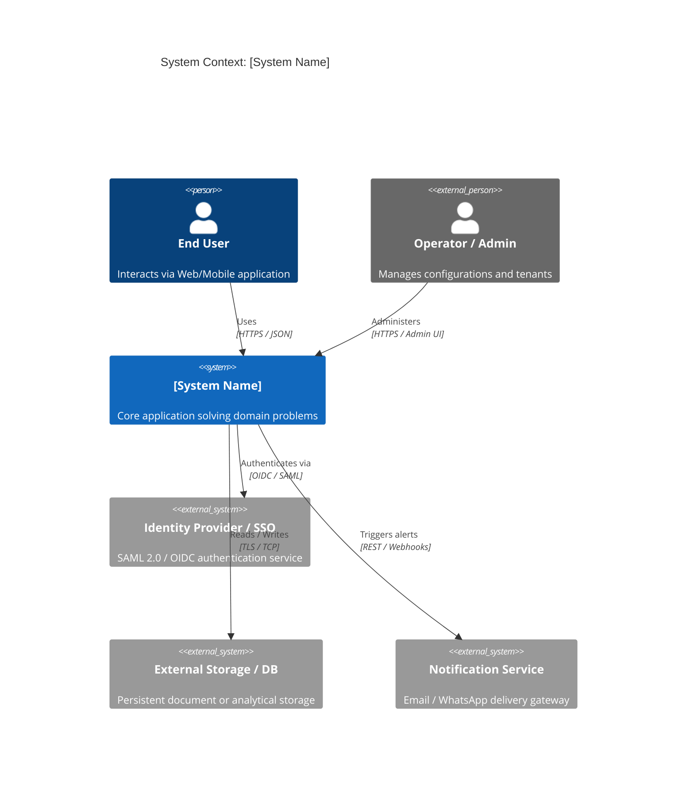
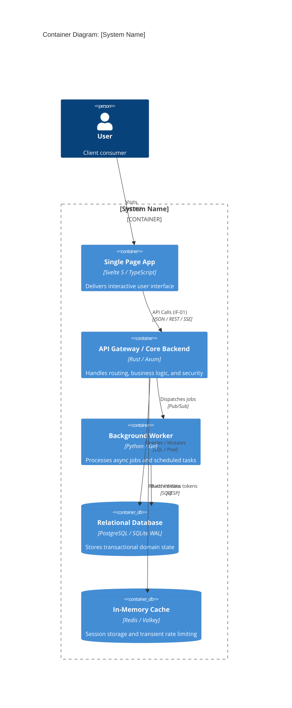
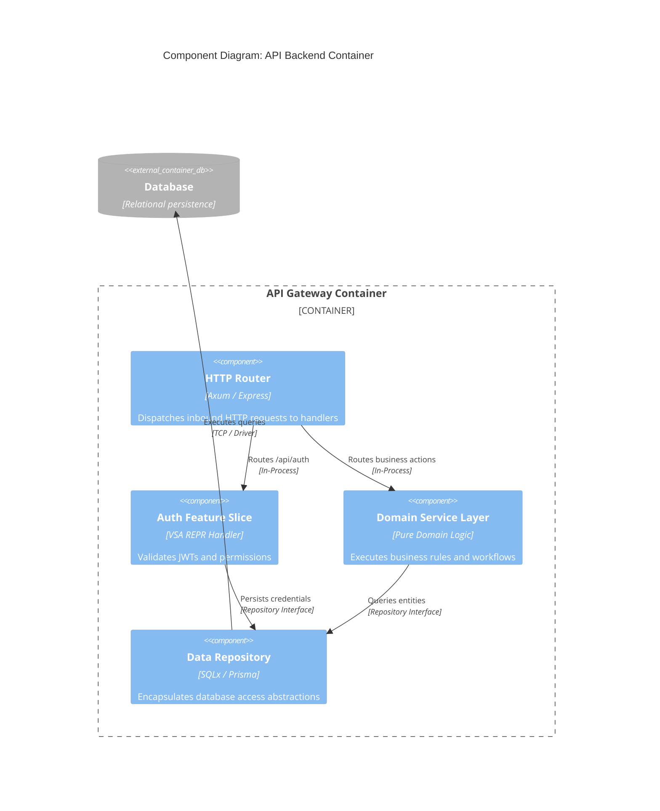
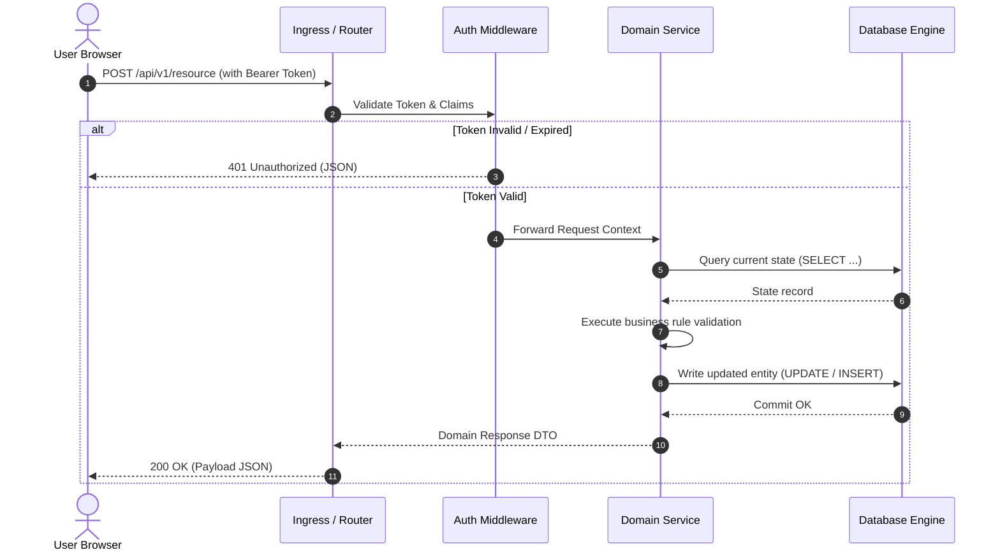

# Mermaid C4 Architecture Diagram Patterns

This reference provides native Mermaid C4 syntax patterns for arc42 architecture documentation.
Unlike PlantUML, Mermaid diagrams render natively in Markdown viewers, GitHub, GitLab, and web artifacts with zero external server dependencies.

---

## 1. System Context Diagram (Section 3: Context and Scope)

Illustrates external actors, systems, and primary high-level boundaries.

---

## 2. Container Diagram (Section 5: Building Block View Level 1)

Illustrates deployable software units (APIs, web applications, databases, workers).

---

## 3. Component Diagram (Section 5: Building Block View Level 2)

Illustrates internal structural components/slices inside a single container.

---

## 4. Runtime Sequence Diagram (Section 6: Runtime View)

Illustrates temporal step-by-step request flow across components.

