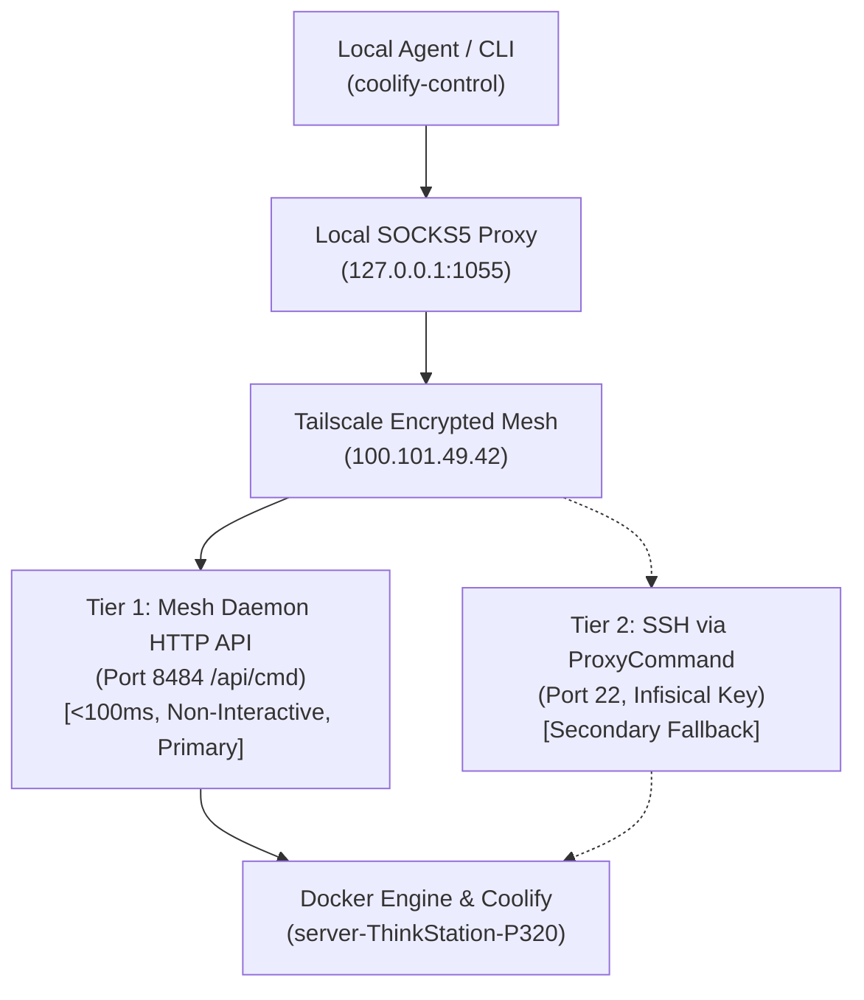
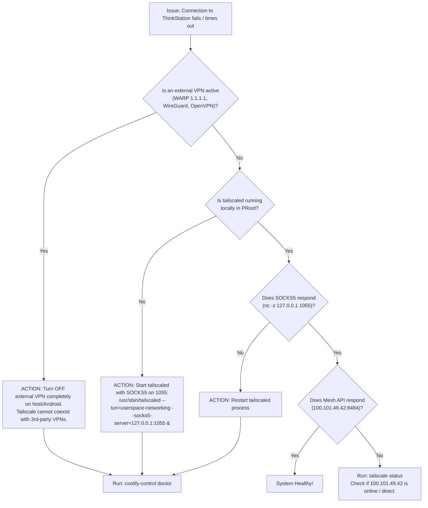

# ThinkStation Coolify & Mesh Control Skill

A unified, container-agnostic skill and CLI tool (`coolify-control`) for managing applications, monitoring live logs, tracking deployments, diagnosing network boundaries, and querying databases on the Lenovo ThinkStation P320 server (`*.dvlpid.my.id`).

---

## 1. Critical Invariant: Zero 3rd-Party VPN Rule (Tailscale Isolation)

> [!CAUTION]
> **Mandatory Rule: ZERO 3RD-PARTY VPNs**
> When connecting to ThinkStation (`100.101.49.42`) via Tailscale WireGuard mesh, the client device (e.g., Android / Termux or Linux workstation) **MUST NOT be connected to any 3rd-party VPN** (such as Cloudflare WARP 1.1.1.1, Outline, WireGuard client, OpenVPN, AdGuard VPN, or corporate VPN tunnels).
>
> **Why?**
> 1. Third-party VPN tunnels hijack default routing tables and block UDP NAT-traversal / STUN / DERP relays required by Tailscale.
> 2. Android only permits one active `VpnService` at a time. If an external VPN is running, all packets to `100.101.49.42` are dropped or routed into a black hole.
> 3. If connections time out, **immediately turn off the external VPN**, ensure `tailscaled` is running locally, and run `coolify-control doctor`.

### PRoot Userspace Networking Protocol
In PRoot on Android, the Linux kernel TUN/TAP device is not directly accessible without root privileges. Tailscale must run in userspace networking mode with a local SOCKS5 proxy:
```bash
# Start tailscaled in userspace mode (listens on 127.0.0.1:1055)
rm -f /var/run/tailscale/tailscaled.sock && \
/usr/sbin/tailscaled \
  --tun=userspace-networking \
  --socks5-server=127.0.0.1:1055 \
  --outbound-http-proxy-listen=127.0.0.1:1055 \
  --state=/var/lib/tailscale/tailscaled.state \
  --socket=/var/run/tailscale/tailscaled.sock &
```

---

## 2. Dual-Tier Transport Architecture

`coolify-control` executes commands using a resilient two-tier architecture:



* **Tier 1 (Mesh HTTP API - Primary)**: Directly targets `http://100.101.49.42:8484/api/cmd` via SOCKS5 proxy `socks5h://127.0.0.1:1055` with Bearer token `agy-universal-mesh-token-2026`. Non-interactive, latency $<100\text{ms}$, avoids SSH interactive web re-auth checks.
* **Tier 2 (SSH via ProxyCommand - Fallback)**: Automatically injects `SERVER_SSH_PRIVATE_KEY` from Infisical (`f13379e0-9661-4f8e-81ef-0e81d1502da1`, env `dev`) and connects using `nc -X 5 -x 127.0.0.1:1055 %h %p`.

---

## 3. CLI Executable: `coolify-control`

The CLI tool is located at:
`~/.gemini/config/skills/thinkstation-coolify/scripts/coolify_control.py`
*(Symlinked globally to `/usr/local/bin/coolify-control`)*

### Core Design Principles:
1. **Machine-Readability First**: Every command supports `--json` with deterministic exit codes.
2. **Zero Interactivity**: Non-blocking batch mode, zero terminal input prompts.
3. **App Alias Auto-Resolution**: Pass friendly names (`cerdas`, `lumis`, `propylon`, `ridm`) instead of full container hashes.
4. **Clean Logs**: Strips ANSI escape codes and silences noisy SSE keepalive heartbeats (`: OPENROUTER PROCESSING`).

---

## 4. Usage Patterns & Workflows

### A. Network & Health Diagnostic (`doctor`)
Run a self-test of Tailscale daemon, SOCKS5 proxy, Mesh API, Docker engine, and VPN conflicts:
```bash
# Terminal human-readable output
coolify-control doctor

# Machine-readable JSON output
coolify-control doctor --json
```

### B. Host & Docker Status (`status`)
Check connection latency, host kernel, uptime, and Docker version:
```bash
coolify-control status [--json]
```

### C. Application & Container Discovery (`apps`)
List running applications or inspect container configuration:
```bash
# List all running containers with Coolify project and domain
coolify-control apps list

# Filter by application, domain, or project
coolify-control apps list --search cerdas
coolify-control apps list --search lumis

# Inspect container environment variables, ports, and volume mounts
coolify-control apps inspect cerdas [--json]
coolify-control apps inspect lumis [--json]
```

### D. Clean Container Logs (`logs`)
Stream container logs with automatic ANSI stripping and SSE noise suppression:
```bash
# View last 100 cleaned log lines
coolify-control logs cerdas

# Tail last 50 lines with timestamps
coolify-control logs cerdas --tail 50 --timestamps

# Error hunter: filter only errors, exceptions, and panics
coolify-control logs cerdas --errors-only
```

### E. Deployment Queue & Build Logs (`deploy`)
Monitor Coolify build pipelines and trigger new deployments:
```bash
# List recent deployments from coolify-db
coolify-control deploy list [--app cerdas] [--limit 10]

# View build / deployment logs
coolify-control deploy logs cerdas [--tail 100]

# Trigger a rebuild and deployment for an application
coolify-control deploy trigger cerdas
coolify-control deploy trigger lumis

# Safely restart a container
coolify-control deploy restart cerdas
```

### F. Automated Database Querying (`db`)
Discover and query databases (MySQL, PostgreSQL, MariaDB, Redis, SQLite volumes) with auto-extracted credentials:
```bash
# List all database containers
coolify-control db list [--json]

# Find database associated with an application
coolify-control db find cerdas
coolify-control db find lumis

# Query MySQL / MariaDB (e.g. Cerdas database)
coolify-control db query h139vp1fyu5dz7sgnq6wg984 --sql "SELECT count(*) FROM users;"

# Query PostgreSQL (e.g. Coolify DB or Propylon)
coolify-control db query coolify-db --sql "SELECT count(*) FROM applications;"

# Query Redis / Valkey
coolify-control db query coolify-redis --sql "PING"
```

### G. Raw Command Execution (`exec`)
Execute arbitrary commands on ThinkStation:
```bash
coolify-control exec "docker ps --format '{{.Names}} {{.Status}}'"
coolify-control exec "free -m && df -h /"
```

---

## 5. Known Application Registry

| Alias | Coolify UUID | Container Prefix | Database Engine | FQDN / Domain |
|---|---|---|---|---|
| `cerdas` | `q4cwk40sso0wocww4c44oso8` | `backend-q4cwk40sso0wocww4c44oso8` | MySQL (`h139vp1fyu5dz7sgnq6wg984`) | `api.dvlpid.my.id`, `app.dvlpid.my.id`, `editor.dvlpid.my.id` |
| `lumis` | `ilzgv2cejxrvmn7g1y3bbu8q` | `lumis-ilzgv2cejxrvmn7g1y3bbu8q` | SQLite (`lumis.db` volume) | `lumis.dvlpid.my.id` |
| `propylon` / `aegis` | `h3r4aia4z4xzksst58vudorj` | `h3r4aia4z4xzksst58vudorj` | PostgreSQL | `propylon.dvlpid.my.id` |
| `ridm` | `ridm` | `ridm-auth` | PostgreSQL (`ridm-postgres`) | `id.dvlpid.my.id` |
| `mediavault` | `mediavault` | `mediavault` | Meilisearch | `media.dvlpid.my.id` |
| `flashlearn` | `rqn4a8luwxwj5e8u58u0w0ao` | `rqn4a8luwxwj5e8u58u0w0ao` | PostgreSQL | `flashlearn.dvlpid.my.id` |
| `forex` | `fmm1i1dj48cq6aq3c3fhiexe` | `api-server-fmm1i1dj...` | PostgreSQL | `forex.dvlpid.my.id` |

---

## 6. Troubleshooting Decision Tree


